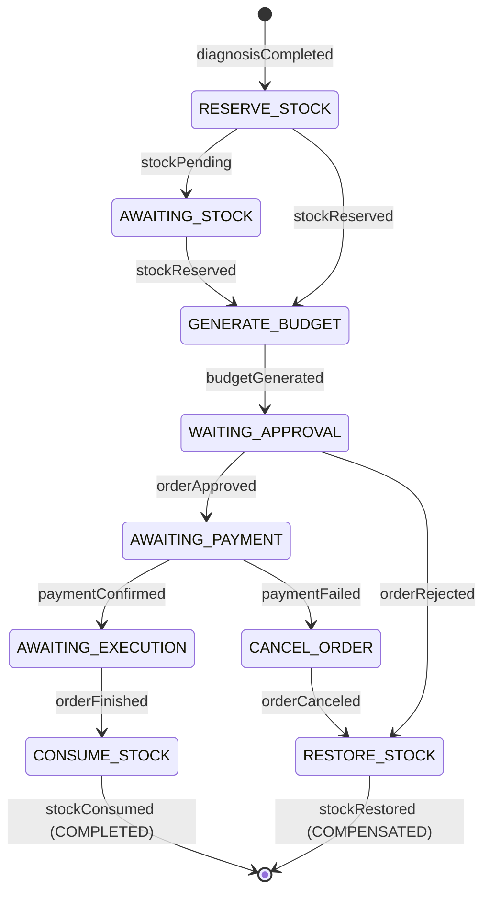

# mechanical-hub-orchestrator

Orquestrador da saga de ordens de serviço do Mechanical Hub: guarda o estado de uma saga por ordem, consome os eventos de `orders`, `stock` e `billing`, decide o próximo passo e publica os comandos de cada serviço, conduzindo também as compensações.

Serviço da Fase 4 (Kotlin, Java 25, Spring Boot 4.1, MongoDB 7 em replica set, Amazon SQS FIFO, ShedLock). Spec: `MechanicalHub/planning/mechanical-hub-orchestrator-spec.md`.

## Responsabilidade

**Faz:** cria e mantém a saga de cada ordem (`transaction_register`), aplica a guarda de passo, publica os comandos via outbox, conduz as compensações (orçamento recusado e pagamento não confirmado), guarda a trilha completa de cada saga (`transaction_history`) e hospeda o BDD do fluxo completo.

**Não faz:** regra de negócio da ordem, do estoque ou do pagamento (cada serviço valida o próprio passo), API para mecânico ou cliente, notificações, chamadas REST aos outros serviços.

Fora do escopo por enquanto: prazo para `AWAITING_STOCK` e compensação automática de sagas paradas (FR-01), ajuste de reparos ou orçamento depois do início da saga (FR-02+). Sagas paradas são localizadas pelo índice `status + currentStep + updatedAt` e pelo painel da saga.

## Papel na saga

Toda a comunicação é por mensagens. O orquestrador lê uma fila e escreve em três:

```
orders ─┐                                              ┌─▶ mechanical-hub-orders-commands.fifo
stock  ─┼─▶ mechanical-hub-orchestrator-events.fifo ─▶ orquestrador ─┼─▶ mechanical-hub-stock-commands.fifo
billing─┘          (eventos)                          (outbox)       └─▶ mechanical-hub-billing-commands.fifo
```

`MessageGroupId = orderId` e `MessageDeduplicationId = eventId` em todas as filas. Envelope JSON: `eventId`, `transactionId`, `orderId`, `type`, `version`, `timestamp` + payload; contexto de trace nos *message attributes*. Todo comando leva `idempotencyKey = {transactionId}:{STEP}`.

Cada evento é processado numa única transação multi-documento do MongoDB: deduplicação por `messageKey = eventId` → guarda de passo (`findOneAndUpdate` filtrando `currentStep`, com `$inc: { seq: n }`) → `transaction_history` (`APPLIED`) → `outbox_events` → `commitTransaction` → só então a mensagem é apagada da fila.

## Máquina de estados

Tabela única no domínio (`domain/statemachine/SagaStateMachine.kt`), sem dependência do Mongo:

| Evento | De | Passo esperado | Próximo passo / status | Publica |
|---|---|---|---|---|
| `diagnosisCompleted` | orders | — (cria a saga) | `RESERVE_STOCK` · `STARTED` | `reserveStock` |
| `stockPending` | stock | `RESERVE_STOCK` | `AWAITING_STOCK` | `markStockPending` |
| `stockReserved` | stock | `RESERVE_STOCK` | `GENERATE_BUDGET` | `generateBudget` |
| `stockReserved` | stock | `AWAITING_STOCK` | `GENERATE_BUDGET` | `clearStockPending`, `generateBudget` |
| `budgetGenerated` | billing | `GENERATE_BUDGET` | `WAITING_APPROVAL` | `sendApproval` |
| `orderApproved` | orders | `WAITING_APPROVAL` | `AWAITING_PAYMENT` | `generatePaymentLink` |
| `orderRejected` | orders | `WAITING_APPROVAL` | `RESTORE_STOCK` · `COMPENSATING` | `restoreStock` |
| `paymentLinkGenerated` | billing | `AWAITING_PAYMENT` (sem link ainda) | — (grava o link) | `sendPaymentLink` |
| `paymentConfirmed` | billing | `AWAITING_PAYMENT` | `AWAITING_EXECUTION` | `releaseOrder` |
| `paymentFailed` | billing | `AWAITING_PAYMENT` | `CANCEL_ORDER` · `COMPENSATING` | `cancelOrder` |
| `orderCanceled` | orders | `CANCEL_ORDER` | `RESTORE_STOCK` | `restoreStock` |
| `orderFinished` | orders | `AWAITING_EXECUTION` | `CONSUME_STOCK` | `consumeStock` |
| `stockConsumed` | stock | `CONSUME_STOCK` | fim · `COMPLETED` | — |
| `stockRestored` | stock | `RESTORE_STOCK` | fim · `COMPENSATED` | — |



Evento num passo diferente do esperado não é erro: a transação é abortada, só a `transaction_history` recebe a linha com `outcome = DISCARDED_STEP_GUARD` e a mensagem é apagada (log `INFO`). Isso cobre duplicatas, mensagens fora de ordem e o `stockReserved` de outras ordens gerado pela redistribuição do `restoreStock`. Um `diagnosisCompleted` repetido esbarra no índice único de `orderId` (`E11000`) e é descartado.

## Falhas e retry

- **Transitório** (`TransientTransactionError`, `WriteConflict`, `NotWritablePrimary`, `UnknownTransactionCommitResult`, timeout): a mensagem não é apagada e o *visibility timeout* é ajustado pela `ApproximateReceiveCount` (1 s → 8 s). No 7º recebimento (`maxReceiveCount = 6`) o SQS a move sozinho para a DLQ.
- **Permanente** (JSON inválido, `type` desconhecido, campo fora do contrato): o consumidor reenvia o mesmo corpo a `mechanical-hub-orchestrator-events-dlq.fifo`, com os atributos `errorClass` e `errorMessage`, e apaga a original.
- **Outbox:** o relay roda a cada 1 s, em lotes de 100 por `createdAt`; por `orderId` publica em ordem de `seq` e não publica o `seq` n+1 enquanto o n estiver `PENDING`. Só a instância líder publica (ShedLock com lease no MongoDB). Erro interrompe o lote e grava `attempts` + `lastError`; o outbox não tem DLQ.

### Como reprocessar a DLQ

Qualquer mensagem na DLQ dispara o alarme do CloudWatch criado pelo `mechanical-hub-infra` (módulo `sqs`) e aparece no painel da saga. Procedimento (`failure_handling.md` §3.3):

1. Ler a mensagem e o motivo:
   ```bash
   aws sqs receive-message --queue-url "$DLQ_URL" --max-number-of-messages 10 \
     --message-attribute-names All --attribute-names All --visibility-timeout 0
   ```
   O corpo traz `orderId` e `eventId`; os atributos `errorClass`/`errorMessage` dizem por que foi para lá (os erros transitórios esgotados chegam sem esses atributos).
2. Conferir a saga da ordem: `GET /transaction/{orderId}` (seção Endpoints) mostra o passo atual e a trilha.
3. Corrigir a causa (deploy de correção ou ajuste no serviço que publicou o evento fora do contrato).
4. Devolver as mensagens à fila de origem pelo redrive nativo (console do SQS → *Start DLQ redrive*, ou):
   ```bash
   aws sqs start-message-move-task \
     --source-arn "$DLQ_ARN" --destination-arn "$EVENTS_QUEUE_ARN"
   ```
5. O reprocessamento é seguro: o `eventId` já aplicado é deduplicado pela `transaction_history` e o passo já avançado é descartado pela guarda.

Prazo: retenção da DLQ (14 dias). URLs e ARNs vêm dos outputs `sqs_dlq_urls`, `sqs_queue_urls` e `sqs_queue_arns` do `mechanical-hub-infra`.

## Endpoints

O serviço é dirigido por mensagens; só expõe endpoints operacionais.

| Rota | Efeito |
|---|---|
| `GET /actuator/health/liveness`, `/actuator/health/readiness` | Probes do Kubernetes. A readiness inclui o MongoDB |
| `GET /actuator/prometheus` | Métricas |
| `GET /transaction/{orderId}` | Saga (`transaction_register`) + `transaction_history` ordenada por `seq`. `404` sem saga, `400` com id inválido. Para depuração e para o vídeo; não está no API Gateway (usar `kubectl port-forward`) |

## Banco (MongoDB)

| Coleção | Conteúdo |
|---|---|
| `transaction_register` | uma saga por ordem (`_id = transactionId`, `orderId`, `status`, `currentStep`, `seq`, `repairs`, `reservedMaterials`, `budget`, `payment`, datas) |
| `transaction_history` | trilha append-only de cada mensagem recebida (`messageKey`, `stepBefore`, `stepAfter`, `outcome`); faz o papel da `inbox_events` |
| `outbox_events` | comandos a publicar (`PENDING` → `SENT`) |
| `shedLock` | lease de liderança do relay |

Índices criados pelo próprio serviço na subida (falha a aplicação se não conseguir). Sem seeds e sem job de limpeza. `writeConcern`/`readConcern` `majority`, transações em `snapshot` e `readPreference: primary`, fixados no código (`MongoConfig`), valendo para qualquer URI.

## Como rodar

Pré-requisitos: JDK 25 e Docker.

```bash
# Unitários, integração (Testcontainers: MongoDB replica set + LocalStack),
# BDD Cucumber, ktlint, detekt e cobertura mínima de 80% (jacoco:check)
./mvnw verify

# Aplicação local: sobe MongoDB (rs0, porta 27017) e LocalStack (4566, as 4
# filas FIFO + DLQs) pelo compose.yaml e roda em http://localhost:8080
./mvnw spring-boot:run -Dspring-boot.run.profiles=local
```

### Simulando os outros serviços localmente

Os eventos podem ser enviados direto à fila do LocalStack. Exemplo de início de saga:

```bash
ORDER_ID=$(uuidgen); EVENT=$(uuidgen)
docker compose exec localstack awslocal sqs send-message \
  --queue-url http://localhost:4566/000000000000/mechanical-hub-orchestrator-events.fifo \
  --message-group-id "$ORDER_ID" --message-deduplication-id "$EVENT" \
  --message-body "{\"eventId\":\"$EVENT\",\"orderId\":\"$ORDER_ID\",\"type\":\"diagnosisCompleted\",\"version\":1,\"timestamp\":\"2026-10-19T12:00:00Z\",\"repairs\":[{\"repairId\":\"03d94934-6201-449b-b8db-490546c35d34\"}]}"

curl -s http://localhost:8080/transaction/$ORDER_ID          # saga em RESERVE_STOCK
docker compose exec localstack awslocal sqs receive-message \
  --queue-url http://localhost:4566/000000000000/mechanical-hub-stock-commands.fifo   # reserveStock
```

Os demais eventos usam o mesmo envelope, com o `transactionId` retornado pela consulta. O fluxo completo está automatizado no BDD (`src/test/resources/features/saga.feature`).

## Configuração

Tudo por variáveis de ambiente (ConfigMap/Secret no cluster). Sem chave AWS: os pods usam a `LabRole` dos nós.

| Variável | Padrão local | Origem no deploy |
|---|---|---|
| `MONGODB_URI` | `mongodb://localhost:27017/mechanical_hub_orchestrator?replicaSet=rs0` | montada pelo pipeline com os outputs `mongodb_*` do `mechanical-hub-database` e usuário/senha do Secret criado por ele |
| `ORCHESTRATOR_EVENTS_QUEUE_URL`, `ORCHESTRATOR_EVENTS_DLQ_URL` | nomes das filas | outputs `sqs_queue_urls` / `sqs_dlq_urls` do `mechanical-hub-infra` |
| `ORDERS_COMMANDS_QUEUE_URL`, `STOCK_COMMANDS_QUEUE_URL`, `BILLING_COMMANDS_QUEUE_URL` | nomes das filas | output `sqs_queue_urls` |
| `AWS_REGION` | `us-east-1` | ConfigMap |
| `OTEL_EXPORTER_OTLP_ENDPOINT`, `OTEL_TRACES_EXPORTER` | — | output `otlp_http_endpoint` (sem coletor: `none`) |

## Deploy

- `Dockerfile` multi-stage (JRE 25, usuário sem privilégios, agente OpenTelemetry com propagação do trace nos *message attributes* do SQS).
- `k8s/`: Namespace `production`, ConfigMap, Secret (`mongodb-uri`), Deployment (requests 250m/640Mi, limits 1 vCPU/1 GiB, probes do actuator), Service NodePort **30083** (target group do NLB no `mechanical-hub-infra`) e HPA de 1 a 2 réplicas.
- `.github/workflows/deploy.yml`: em PR, `verify` + SonarQube Cloud (quality gate); na `main` ou chamado pelo *Deploy completo* (`deploy-all.yml` do `mechanical-hub-infra`), também lê os remote states (`ci/remote-state`), monta a URI do MongoDB a partir do Secret do `mechanical-hub-database`, publica a imagem no ECR `mechanical-hub/orchestrator`, aplica os manifestos no EKS e roda `ci/smoke-test.sh`.
- Smoke test: readiness (aplicação + MongoDB) em cada pod, `GET /transaction` (404/400), métricas expostas e uma **sonda SQS**: publica na fila de eventos um `stockConsumed` de uma ordem inexistente e espera o contador `saga_messages_total{type="stockConsumed",outcome="DISCARDED_STEP_GUARD"}` subir — prova consumo do SQS pela `LabRole`, escrita no MongoDB e confirmação da mensagem, sem criar saga nem publicar comando (fica só a linha de auditoria da sonda).

Secrets/variáveis (no nível da organização `mechanical-hub-fiap`): `AWS_ACCESS_KEY_ID`, `AWS_SECRET_ACCESS_KEY`, `AWS_SESSION_TOKEN`, `AWS_ACCOUNT_ID`, `SONAR_TOKEN`; variável `SONAR_ORGANIZATION`. Não há secret de banco: a senha do MongoDB vem do Secret do Kubernetes criado pelo `mechanical-hub-database`.

Ordem no ambiente zerado (`infrastructure.md` §7): `mechanical-hub-infra` (filas e ECR) → `mechanical-hub-database` (MongoDB e usuário do orchestrator) → este pipeline. O *Deploy completo* já segue essa ordem.

O smoke test também roda localmente: com a aplicação no profile `local`, `AWS_ENDPOINT_URL=http://localhost:4566 AWS_ACCESS_KEY_ID=test AWS_SECRET_ACCESS_KEY=test AWS_DEFAULT_REGION=us-east-1 EVENTS_QUEUE_URL=http://localhost:4566/000000000000/mechanical-hub-orchestrator-events.fifo ci/smoke-test.sh http://localhost:8080`.

## Observabilidade

- `/actuator/prometheus` (raspado pelo `mechanical-hub-infra` pelo label `app.kubernetes.io/name: orchestrator`): `saga_started_total`, `saga_finished_total{status}`, `saga_messages_total{type, outcome}`, `saga_active{current_step}` e `outbox_oldest_pending_age_seconds` (alerta > 60 s).
- Painel *Mechanical Hub — Saga* no Grafana (sagas por passo, compensações, descartes, outbox pendente, profundidade das filas e DLQs via CloudWatch); o alarme de DLQ > 0 fica no CloudWatch (módulo `sqs` do `mechanical-hub-infra`).
- Logs JSON com `orderId`, `transactionId`, `eventId`, `currentStep`, `trace_id` e `span_id`.
- Traces pelo agente OpenTelemetry; o contexto chega pelos *message attributes* do SQS e segue nos comandos publicados pelo relay.

## Cobertura e BDD

Evidência da execução de `./mvnw verify` em 2026-10-11 (160 testes, 0 falhas):

| Escopo | Cobertura de linhas |
|---|---|
| Total (JaCoCo, mesmas exclusões do Sonar) | **98,5%** (1283 de 1302 linhas) |
| `domain` | 99,7% |
| `application` | 98,7% |
| `infrastructure` | 97,9% |

Cobertura de branches: 87,9%. O build falha abaixo de 80% de linhas (`jacoco:check`). Relatório HTML em `target/site/jacoco/index.html` e, no CI, no artefato `jacoco-report`; o SonarQube Cloud lê o `jacoco.xml` no quality gate do PR.

Cenários BDD (`saga.feature`, Cucumber com MongoDB e LocalStack em Testcontainers; os outros serviços são simulados pelas mensagens que publicariam), todos aprovados:

| Cenário | Resultado |
|---|---|
| Caminho feliz | ✅ |
| Pendência de estoque | ✅ |
| Orçamento recusado | ✅ |
| Pagamento não confirmado | ✅ |
| Pagamento confirmado pelo job do billing sem o link ter sido enviado | ✅ |
| Evento duplicado é aplicado uma só vez | ✅ |
| Diagnóstico repetido não cria uma segunda saga | ✅ |
| Mensagem fora de ordem é descartada pela guarda de passo | ✅ |

Relatório em `target/cucumber-report/cucumber.html` e, no CI, no artefato `cucumber-report` de cada execução.
